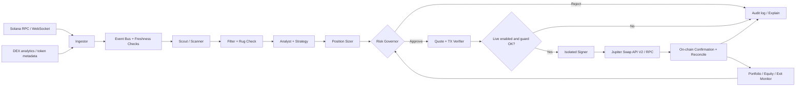
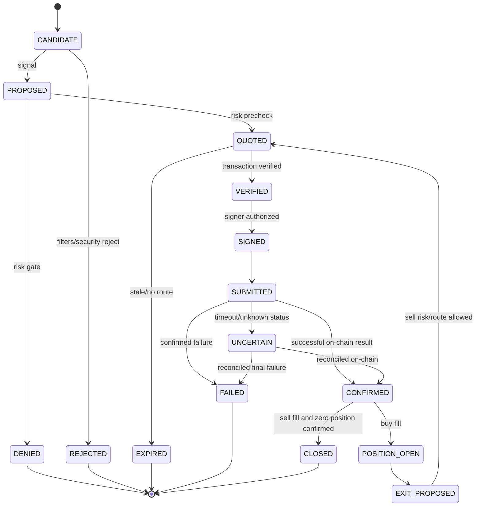

# PRODUCT REQUIREMENTS DOCUMENT (PRD)
# SOLANA SENTINEL — Autonomous Multi-Agent Meme Coin Trading System

**Versi:** 2.0 — 1 November 2026 (supersedes v1; authoritative product scope)  
**Status:** PRODUCT SPECIFICATION ONLY; BELUM ada kode, BELUM diuji live. Dokumen di folder ini tidak membuktikan eksekusi aktual.  
**Pemilik produk:** Pengguna pemula; penggunaan awal untuk akun dan wallet milik sendiri  
**Target eksekusi:** Solana mainnet; trading nyata hanya setelah tahapan kesiapan dan persetujuan aktivasi oleh pemilik wallet  
**Bahasa UI:** Indonesia (istilah teknis disertai tooltip)  
**Sumber awal modal yang dipertimbangkan:** sekitar 1 SOL; ini adalah batas sumber daya awal, BUKAN alokasi risiko yang direkomendasikan.

> **Kontrak kejujuran:** Sistem harus dapat melakukan swap on-chain sungguhan bila syarat promosi live terpenuhi, tetapi tidak boleh menjanjikan profit, kemenangan, kecepatan eksekusi, kebal rug pull, ataupun kinerja seperti video. Trading meme coin dapat kehilangan 100% dari modal berisiko. Semua capaian perlu dibuktikan lewat transaksi, data, log, dan pengujian yang dapat diaudit.

---

## 0. Keputusan kelayakan dan definisi tanggung jawab

**Kelayakan teknis: YA, dengan pembeda penting.** Codex dipakai untuk **merancang, menulis, menguji, mengaudit, dan merilis kode**, bukan sebagai satu sesi percakapan yang harus hidup terus untuk melayani setiap tick harga. Robot berjalan sebagai **aplikasi mandiri (worker + dashboard + DB + network adapters)** di komputer yang selalu menyala atau server yang dikelola sendiri. Setelah operator menyetujui scope, batas risiko, dan aktivasi live, aplikasi dapat melakukan keputusan/transaksi sesuai kebijakan tanpa klik manual per trade. Pemilik harus tetap mampu memantau, menghentikan, menarik aset, dan mencabut kunci; bot dapat berhenti otomatis ketika menghadapi kesalahan atau batas risiko.

**Yang dapat dibuktikan:** real-time data, screening, deliberasi multi-agent, keputusan, signing terkendali, transaksi mainnet, signature, PnL terverifikasi, fail-safe.  
**Yang tidak dapat dijanjikan:** profit positif, bebas rug pull, 24/7 tanpa gangguan, zero-latency, copy trade selalu seharga wallet asal, atau persamaan hasil modal yang muncul dalam video.

**Batas penggunaan:** self-hosted untuk dana pemilik sendiri, **bukan** mengelola dana pihak ketiga, bukan menawarkan jasa investasi, bukan menghindari KYC/ketentuan perizinan Indonesia. Periksa penyedia on-ramp/off-ramp dan ketentuan terkini sebelum live.

## 1. Analisis 3 lampiran — apa yang benar-benar terlihat

| Lampiran | Bukti visual yang dapat diidentifikasi | Interpretasi kerja | Yang belum terbukti |
|---|---|---|---|
| `IMG_0239.jpg` | Halaman `New bot`, nama `DESK`, job terkait Solana; deskripsi `SCAN -> VERIFY -> EXECUTE -> EXIT`, tetapi juga menulis `You never buy, sell, sign or move funds` | Bot DESK dapat diperlakukan sebagai perencana/pengarah **tanpa** izin wallet | Apakah mempunyai infrastruktur koneksi on-chain, dan hubungan antara DESK dengan executor |
| `IMG_0238.MOV` (~13 dtk) | `Grok Bot / GROKIUS terminal`, sidebar Overview, Copy feed, Smart wallets, Rules, Risk guard; lima role `Scout`, `Filter`, `Analyst`, `Sniper`, `Guard`; grafik equity, posisi, PnL token, wallet radar, copy log, angka wallet yang dipantau | Referensi untuk pola **wallet intelligence/copy trading + dashboard event-driven** | Signature transaksi, modal awal sebenarnya, fee, drawdown sesungguhnya, apakah rekaman dipercepat, apakah data simulasi |
| `IMG_0241.MOV` (~20,4 dtk) | `Grok Bot Terminal`, enam role `Scanner`, `Rug Check`, `Sizer`, `Executor`, `Logger`, `Equity`; `SCAN -> CHECK -> SIZE -> EXEC -> LOG`, setup decision/kill, ledger, balance ladder, hitungan waktu yang melompat | Referensi untuk pola **risk-first automated trading pipeline** | Keaslian balance yang tampak, transaksi on-chain, kemampuan keluar dari posisi illiquid, kesesuaian sistem dengan pasar aktual |

**Catatan:** Dalam video terlihat angka equity yang bertambah cepat. Angka visual bukan bukti pendapatan nyata ataupun reproducible return. Tidak boleh mengubah rekaman tersebut menjadi klaim performa yang terverifikasi. Rancang UI yang *terinspirasi struktur informasi* referensi, bukan mengklaim menggunakan produk atau API Grok yang belum terverifikasi.

### 1.1 Pemetaan role referensi ke desain sistem

- `DESK` (gambar) -> **Orchestrator**: mengoordinasikan event dan memutuskan apakah kandidat boleh masuk ke pipeline; tidak boleh mengakses secret atau menandatangani transaksi.
- `Scout` / `Scanner` -> **Discovery Agent**: temukan token/pair baru dan perubahan volume/liquidity; hindari kesimpulan tanpa sumber.
- `Filter` -> **Market Filter**: cek usia pool, liquidity, volume, spread/price impact, tradeability, data quality.
- `Analyst` -> **Signal Analyst**: menilai pergerakan dan konteks; output structured score dan bukti; AI opsional.
- `Rug Check` -> **Security Agent**: veto mutlak atas risiko otoritas token, holder concentration, transfer restrictions, route aneh, data tidak tersedia.
- `Sniper` -> **Strategy Agent**: menghitung sinyal entry/exit dan horizon; **tidak** mengirim transaksi langsung. Istilah “sniper” tidak berarti jaminan menang pada peluncuran token.
- `Sizer` -> **Position Sizer**: memberi proposal ukuran transaksi dengan memperhatikan saldo, reserve fee, exposure, liquidity, quote impact.
- `Guard` -> **Risk Governor**: izin/penolakan final dengan aturan deterministik; tidak tunduk pada mayoritas voting AI.
- `Executor` -> **Execution Worker**: satu-satunya komponen yang diizinkan mengakses signing service; harus memverifikasi program transaksi, batas biaya, dan quote ulang.
- `Logger` -> **Audit & Reconciliation Agent**: append-only event audit, signature, posisi, fee, kegagalan, PnL, alasan keputusan.
- `Equity` -> **Portfolio Observer**: membaca saldo on-chain, menghitung realized/unrealized PnL terpisah, dan memberikan grafik.

## 2. Persoalan pengguna, sasaran produk, dan non-goals

**Persona:** pemula yang belum paham pembelian SOL, transfer via jaringan Solana, wallet non-custodial, cara exit dari meme coin, atau perbedaan profit di UI vs dana cair. Modal awal terbatas; akses Codex melalui ChatGPT Plus tidak identik dengan kredit OpenAI API runtime.

**Jobs-to-be-done:** (i) belajar alur deposit dan withdrawal dengan aman; (ii) memantau token dan wallet di jaringan Solana; (iii) memahami mengapa trade dilakukan/ditolak; (iv) membiarkan sistem melakukan trade sesuai mandat risiko yang sudah disetujui; (v) mengukur hasil nyata dengan bukti blockchain; (vi) mengendalikan kerugian dan mampu melakukan emergency stop.

**Prioritas keberhasilan:** Kebenaran dan integritas aset > pembatasan risiko > reliabilitas transaksi > keterjelasan keputusan > UX > kecepatan > profit.

**Non-goals P0:** menyalin persis hasil USD pada video; high-frequency trading berlatensi mikrodetik; arbitrase berleverage; kontrak derivatif; front-running/sandwich/market manipulation; mengelola dana orang lain; meluncurkan token; pembelian yang membutuhkan bypass anti-bot/KYC; strategi profit guaranteed; auto cash-out ke bank tanpa akun/exchange yang diotorisasi; mengikuti semua wallet tanpa filter.

## 3. Tahapan operasi — modes dan hak akses

| Mode | Akses market | Signer | Transaksi chain | Kegunaan |
|---|---|---|---|---|
| `OBSERVE` | Data live | Tidak ada | Tidak | Verifikasi konektor, token discovery, kualitas data |
| `PAPER` | Data live & quote | Tidak ada | Tidak | Simulasi decision-making dengan estimasi spread, price impact, fees, latency |
| `SHADOW` | Data live; generate unsigned order, simulate tx bila sesuai | Tidak ada | Tidak | Bandingkan peluang, quote, hasil re-pricing dan kebijakan tanpa risiko dana |
| `MICRO_LIVE` | Data live | Hot wallet terbatas dan diaktifkan eksplisit | **Ya, nominal sangat kecil** | Uji satu putaran BUY dan SELL asli dengan bukti blockchain; perlu konfirmasi aktivasi mode oleh pemilik, tidak perlu persetujuan per trade dalam batas |
| `CAPPED_AUTO` | Data live | Hot wallet terbatas dan diaktifkan eksplisit | **Ya, otomatis dalam limit** | Operasi unattended dengan ceiling kerugian/posisi/frekuensi/konsumsi fee yang ketat |
| `HALTED` | Baca saja | Tidak boleh sign | Tidak | Kondisi failure, manual pause, hit hard stop, data invalid, atau dana tidak aman |

P0 wajib mencakup OBSERVE, PAPER, SHADOW, MICRO_LIVE, HALTED. CAPPED_AUTO hanya boleh dibuat aktif setelah kriteria P1/live-gate terpenuhi. Toggle live tidak boleh terbuka hanya karena pengembang mengklaim aplikasi selesai. Perubahan mode dan batas risiko harus memerlukan autentikasi ulang pemilik.

## 4. Workflow end-to-end dan arsitektur



**Prinsip non-negotiable:** Tidak ada pesan bahasa alami dari agent yang dapat langsung men-trigger transaksi. Semua melewati typed proposal, evidence/freshness checks, Risk Governor deterministik, single signer boundary, dan rekonsiliasi on-chain. Bot boleh “berdiskusi”, tetapi veto risiko bersifat hierarkis; voting mayoritas tidak bisa mengalahkan safety rule.

### 4.1 Komponen teknis yang direkomendasikan

- `apps/web`: dashboard Next.js + TypeScript, read-only market screens; autentikasi untuk kontrol; WebSocket/SSE dashboard dari backend (dashboard bukan trading runtime).
- `apps/worker`: Node.js LTS + TypeScript service untuk subscriptions, data adapters, event queue, strategy evaluation, position lifecycle, trade reconciliation.
- `packages/domain`: Zod/TypeScript schema untuk TokenCandidate, RiskAssessment, TradeProposal, RiskDecision, ExecutionIntent, Fill, Position, PnL, AuditEvent.
- `packages/connectors`: provider interface untuk Jupiter Swap API V2, Solana RPC/WebSocket, DEX Screener, Helius (jika dipakai), security metadata.
- `packages/engine`: deterministic Risk Governor + Strategy, quote refresh, decision engine.
- `packages/signer`: komponen signing minimal, isolated, vault-backed atau OS secrets; tidak dapat diakses lewat dashboard browser, LLM, atau prompt.
- `packages/replay`: paper trader dan replay harness dengan harga/fee/latensi konservatif.
- `DB`: **PostgreSQL** untuk state transaksi/ledger dan outbox atomik walau web + API + worker terpisah; development via Docker Compose. Redis tidak wajib P0. Gunakan migrasi database dan transaksi serializable/row locks untuk intent. Jangan beralih ke SQLite pada runtime multi-proses tanpa ADR eksplisit.
- `ops`: config, migrations, secure env template, health checks, restart policy, backup/restore, audit scripts.

**Platform awal:** lokal di komputer pengguna untuk develop dan fase pengujian; untuk truly 24/7 perlu host stabil (komputer selalu hidup atau VPS yang terkelola) dengan hardening, jaringan stabil, firewall, monitoring, persistent data dan encrypted secrets. Codex Cloud bukan pengganti terjamin bagi runtime trading production. Pada Windows gunakan layanan yang bisa restart setelah reboot, bukan sekadar tab browser/terminal aktif.

**Model AI:** optional LLM untuk penjelasan/deliberasi terbatas, dengan respons JSON terstruktur dan fallback no-trade; bukan pengambil keputusan tunggal. Rule-based statistical signal tetap berfungsi jika API AI tidak ada atau kuota habis. Penggunaan OpenAI API di bot production **ditagih terpisah** dari ChatGPT Plus; boleh dimatikan sama sekali untuk P0.

## 5. Persyaratan fungsional (FR)

| ID | Prioritas | Requirement | Acceptance evidence |
|---|---|---|---|
| FR-001 | P0 | Wizard edukasi pemula: exchange Indonesia, KYC, IDR->SOL, wallet, alamat deposit, jaringan, test transfer, withdrawal | UI + e2e walkthrough; tidak meminta seed phrase |
| FR-002 | P0 | Connection status Solana RPC/WebSocket, clock skew, reconnect backoff, lag telemetry | chaos tests disconnect & recover |
| FR-003 | P0 | DEX discovery token/pool dengan mint address sebagai canonical ID | Event + normalized raw payload |
| FR-004 | P0 | Deduplication candidate/token, ignore invalid or insufficiently fresh sources | tests duplicate, out-of-order, missing data |
| FR-005 | P0 | Filter market cap/liquidity/volume/price impact/age/quote feasibility | pass/reject evidence dan source timestamps |
| FR-006 | P0 | Security analysis: mint/freeze authority, Token-2022 extensions, concentration, transfer risks, program allowlist | default reject/hold on unknown high-risk fields |
| FR-007 | P0 | Watchlist smart wallet; ingest public address only, track inflow/outflow/swap, lag/copyability | backfilled chain data + replay; NO access to source keys |
| FR-008 | P1 | Statistik sumber wallet: observed trades, fees, realized PnL confidence, latency, survivorship warnings | source-quality report |
| FR-009 | P0 | Multi-agent deliberation: structured proposals, dissent, reason IDs, no free-text order | explicit audit graph |
| FR-010 | P0 | Position sizing by deterministic limits; fresh quote, available balance, fee reserve | unit/property tests |
| FR-011 | P0 | Account-level risk limits: position max, total notional, trade count, daily loss, price impact, slippage, gas, cooldown | deny overriding agent signal |
| FR-012 | P0 | PAPER/SHADOW simulated execution with fees, nonfillable quotes and fill uncertainty | replay logs distinguish simulated vs live |
| FR-013 | P0 | Mainnet execution connector: Jupiter Swap API V2 `/order` + sign + `/execute` in authorized modes | verified BUY and SELL signatures, quote and fill |
| FR-014 | P0 | Transaction verification before signing: expected input/output mints, amounts, destination program allowlist, fee payer, no additional transfers | malformed/rogue tx rejected |
| FR-015 | P0 | Executor idempotency & unique intent ID; tx lifecycle; recover after timeout/restart | no duplicate submission in tests |
| FR-016 | P0 | Confirm via chain; reconcile fills and token accounts; classify unknown finality | on-chain explorer signature + raw receipt |
| FR-017 | P0 | Exit engine: configurable condition-based exit; stale prices, liquidity drop and fail-stop | staged exit tests including impossible sell |
| FR-018 | P0 | Portfolio separation: available SOL, reserved gas, token balance, realized/unrealized PnL, fees, net deposits | independent balance reconciliation |
| FR-019 | P0 | Live activity dashboard: agent states, decision stream, rejection reasons, open/closed positions, transaction hashes, health | Playwright screenshots + trace |
| FR-020 | P0 | Persistent append-only audit log with correlation IDs, timestamps, raw source hashes, config version | read/restore proof |
| FR-021 | P0 | Emergency stop disables **new entries immediately**, cancels pending executable intents, continues observing existing exposure; emergency exit only via separately configured policy | kill-switch tests |
| FR-022 | P0 | Non-custodial hot-wallet onboarding with separate trading wallet; no keys sent to AI/website/logs | secret scan + runtime isolation test |
| FR-023 | P0 | State machine after process restart with chain reconciliation before any resend | fault-injection recovery test |
| FR-024 | P1 | Per-provider rate-limit, circuit-breaker, cost budgets and graceful degradation | provider outage tests |
| FR-025 | P1 | Optional LLM council (read-only structured output), fallback to no-LLM scoring | token cost ledger + disabled-AI tests |
| FR-026 | P1 | Alert to owner for halted, signing fault, drawdown breach, data stale, wallet balance mismatch | delivery test; alerts cannot be only safety control |
| FR-027 | P1 | Export audit CSV/JSON, reproducible report, buy/sell matched trade provenance | independent audit script |
| FR-028 | P2 | Comparative wallet-cluster visualization, advanced smart wallet statistics, Telegram notices | post-MVP scope |

## 6. Data & source integration (verify before implementation)

**1. Jupiter Swap API V2**: current documented path `https://api.jup.ag/swap/v2/order` for quote & assembled transaction and `/execute` for signed transaction. Orders must be bound to correct token mint, amount (base units), taker, route/price constraints, short lifetime. Response signed outside of Jupiter, and signing only after transaction contents are checked. `/build` is a distinct custom path and must not be casually mixed with `/execute`. Refresh docs immediately before implementation (APIs change). Mainnet viability depends on route availability.

**2. Solana RPC/WebSocket**: use RPC for state/confirmations, WebSocket for subscriptions; reconnect and backfill gaps from RPC. Public endpoint rate limits are not suited to uncontrolled high-volume listeners. Choose reputable provider with documented rate limits; Helius standard/enhanced websocket is a provider option, NOT a requirement. Store observed slot, commitment, update timestamp and provenance. Do not assume `processed` = final transaction.

**3. DEX Screener**: discovery/market info (pool liquidity, volume, price, pairCreatedAt, txns). It is a market discovery source, not financial ground truth for fills. Respect endpoint rate limits and terms, and keep a caching/rate-budget adapter.

**4. Security checks**: query actual Solana token program state for mint/freeze authority; inspect Token-2022 extensions (e.g. transfer fees/transfer hooks) and token accounts. For holder concentration use reliable chain indexer/RPC; security-scoring vendors may supplement but never replace validation. Some risks (team collusion, deceptive liquidity, volatile exits) are fundamentally non-detectable with certainty.

**5. Smart-wallet intelligence**: subscribe to a finite owner-configured watchlist. Track swaps and money flows; normalize tokens by mint addresses; delay and incomplete-data warnings. Prohibit copying blindly when observed wallet buys its own token, when illiquid, or when market changed materially before our quote. Public leaderboards can be gamed; profit stats may be survivorship-biased.

**6. Data guardrails**: source timestamps, TTL per signal, quoted snapshot hash, min source quorum, ticker/name collision defenses, RPC state corroboration, versioned adapter contracts, optional provider fallback, circuit breaker, no invented values.

## 7. Multi-agent decision protocol

Each agent MUST emit a **typed decision** object. Example (illustrative; no real token):

```json
{
  "decision_id": "dec_000001",
  "candidate_mint": "<REAL_MINT_ADDRESS_FROM_CHAIN>",
  "source_chain": "solana-mainnet",
  "observed_slot": 123456,
  "evidence_timestamp_utc": "2026-11-01T00:00:00Z",
  "roles": {
    "scout": {"state":"CANDIDATE", "evidence_ids":["src_11"]},
    "filter": {"state":"PASS", "evidence_ids":["src_12"]},
    "security": {"state":"PASS", "evidence_ids":["src_13"]},
    "analyst": {"state":"CONDITIONAL_BUY", "score":0.58, "reason_codes":["VOLUME_ACCELERATING"]},
    "strategy": {"state":"BUY_CANDIDATE", "reason_codes":["ENTRY_SIGNAL"]},
    "sizer": {"state":"PROPOSED", "amount_lamports":"<CALCULATED_AMOUNT>"}
  },
  "risk_governor": {"state":"DENY", "reason_codes":["QUOTE_STALE"]},
  "effective_action":"SKIP"
}
```

*`observed_slot` dan waktu di atas adalah contoh skema, bukan data mainnet yang terobservasi.*

**Governance rules:**
1. Agent tidak memiliki wallet private key, API credential signing, atau arbitrarily executable commands.
2. Security Agent and Risk Governor can veto. Tidak ada majority-vote override terhadap `DENY`.
3. Decisions must cite source IDs and whether `LIVE`, `PAPER`, or `SHADOW`.
4. Disagreement => SKIP unless a previously specified deterministic threshold resolves it without violating risk gates.
5. Missing/stale/inconsistent market info => `SKIP`/`HALT`, not inferred data.
6. Any model-generated text is untrusted data; cannot modify risk configuration or shell commands.
7. Different strategies cannot increase shared risk budget by spawning agents/wallets or splitting requests.
8. No continuous prompting of expensive LLM at every market tick; event triggers/rate limits and cheap deterministic baseline first.

## 8. Trading lifecycle, state machine, and exit semantics



No retry of `SUBMITTED/UNCERTAIN` trade until check signature, blockhash expiry and affected token balances, because an RPC timeout does not prove transaction failure. A duplicate BUY is a financial incident. Idempotency key is `(wallet, strategy, token_mint, intent_version, side)` plus durable unique order record; durable nonce/transaction signature handled per protocol. Token lot accounting uses confirmed balance deltas.

**EXIT/stop-loss limitations:** A stop-loss is an instruction to *attempt* to exit, not a guarantee of filled price or liquidity. If a token cannot be sold, bot logs `EXIT_BLOCKED`, prioritizes notifying operator, stops opening new positions under severe risk, and **never** fabricates a closed position. Do not allow unbounded slippage simply to force an exit.

**Risk governor examples (configuration placeholders, NOT chosen numbers):** `max_hot_wallet_balance_sol`, `max_trade_size_sol`, `max_total_open_exposure_sol`, `max_open_positions`, `max_daily_realized_plus_unrealized_loss_sol`, `max_daily_fees_sol`, `max_slippage_bps`, `max_price_impact_bps`, `min_pool_liquidity`, `min_quote_freshness_ms`, `max_scanned_events_min`, `max_trades_hour`, `cooldown_sec`, `max_consecutive_failures`, `min_reserved_sol_for_gas`, `allowed_program_ids`, `trusted_rpc_endpoints`, `token_denylist`. Set explicit owner-reviewed limits after paper observation, not from LLM guesses.

**Account-level stops:** The Risk Governor measures risk across *all* strategies and positions using on-chain mark-to-market with uncertainty indicators. After halt, no new entries; emergency sale only if prior policy explicitly permits and bounded by route/transaction checks.

## 9. Wallet, credential safety, and onboarding UX

### 9.1 Wallet policy

- Use **separate hot trading wallet** funded with a small, explicitly risked amount; do not expose main wallet seed to the bot.
- The private key is generated/imported ONLY through a local secured setup flow; the AI chat, screenshots, logs, PRD, Git, telemetry, and third-party analysis APIs must never receive secret or recovery phrase.
- Any secret handling requires encrypted-at-rest protection or OS credential management, strict process identity permissions, no arbitrary process command execution in signing module, zero server-side debug secret dumps, audit and tamper-resistant config changes.
- Only the signer service can sign and only after verifying destination programs, token mints, expected input output, fee bounds, owner address, freshness and replay protection. Never auto-approve unlimited third-party delegations.
- Do not allow bot to transfer arbitrary SOL to external addresses, or to create withdrawal destinations; non-trading outbound transfers disabled by design. User manually withdraws via trusted wallet/exchange.
- Never assume local secrets are safe if the host is compromised. Signing safety on a general-purpose online device has inherent custodial risk; a compromised system can lose its full hot-wallet balance.
- Provide `REVOKE_TRADING`: disable hot-wallet service, rotate credentials where possible, and move remaining funds from the trading wallet using a separate wallet app if safe. Risk remains for already-broadcast txs.

### 9.2 Beginner onboarding, before any deposit

1. Explain in plain Indonesian: SOL native coin used for blockchain fees; meme coin is a highly speculative token; chain address is not a bank account; token ticker alone is not trusted identity.
2. Select a crypto platform with up-to-date Indonesian authorization, confirm registration/whitelist at OJK site; complete mandatory KYC on the provider's official app/site. Avoid links from DMs.
3. Deposit IDR into personal exchange account via supported local channel; buy SOL only after checking pricing and transfer/withdrawal costs.
4. Create a trusted Solana-compatible self-custody wallet (for example a reputable provider obtained from its official site); write recovery phrase offline and keep it private. Never enter seed phrases into our dashboard, Codex, support chats, browser forms, or Telegram.
5. Create a separate trading wallet. Review **Solana network**, recipient **full public address**, amount and transaction fee. Send a tiny test transfer first and verify balance on an independent explorer before further funding.
6. Initially run READ-ONLY, PAPER and SHADOW. Fund hot wallet for MICRO_LIVE only when the safety gate is demonstrably passed and owner expressly authorizes.
7. Monitor wallet address and net cost in SOL. To withdraw: disable/pause trading, settle open positions if possible, manually send SOL from trading wallet to exchange's verified SOL deposit address on the supported network (test transfer recommended), then sell to IDR and use exchange bank withdrawal. Token deposits may not be supported; usually swap token to SOL first if tradable.
8. Confirm exchange minimum transfer/withdrawal requirements, tax reporting, platform support for SOL, fees, compliance, withdrawal timing, and risk.

**Capital caution:** 1 SOL is too limited for aggressive high-frequency live speculation because price impact, failed swaps, priority fees, rent deposits for token accounts, external data costs, and irrecoverable losses can consume disproportionate capital. The platform must reserve SOL for fees and cannot use “full balance” sizing by default. Loss limit can prevent further new trades, not undo past losses.

## 10. Nonfunctional requirements (NFR)

| ID | NFR | Testable target/gate |
|---|---|---|
| NFR-01 | Security-first fail-closed | 100% prohibited signing tests rejected; no key exposure in tests/logs |
| NFR-02 | Proof of real execution | every LIVE entry/exit has valid explorer-viewable signature and chain-confirmed balances |
| NFR-03 | Isolation | web/LLM/Scout/Analyst cannot invoke signer directly |
| NFR-04 | Reliability | restart process under active intents -> no duplicate live order |
| NFR-05 | Freshness | no trade if market/quote exceeds owner-defined TTL or chain clock inconsistent |
| NFR-06 | Clarity | every skipped/traded candidate shows reason codes and source links, not vague AI text |
| NFR-07 | Performance | capture observed end-to-end p50/p95 decision and quote-to-submit latency; no invented target |
| NFR-08 | Cost accountability | account for swap/platform fees, priority, rent, provider and AI API costs |
| NFR-09 | Portability | reproducible install on developer laptop; 24/7 host is distinct deployment requirement |
| NFR-10 | Accessibility | Indonesian explanation, warning before live activation, mobile-responsive read-only dashboard |
| NFR-11 | Privacy | no sensitive wallet metadata sent unnecessarily; sanitize addresses in public telemetry |
| NFR-12 | Data persistence | backup/restore and ledger chain reconciliation proof |

### Observability metrics

`event_age_ms`, `ws_disconnects`, `provider_errors_5m`, `quote_latency_ms`, `decision_latency_ms`, `tx_confirmation_latency_ms`, `trades_attempted`, `trades_confirmed`, `failed_or_unknown_txs`, `slippage_actual_bps`, `gas_fee_sol`, `priority_fee_sol`, `effective_execution_price`, `wallet_delta_sol`, `strategy_realized_pnl_sol`, `strategy_unrealized_pnl_sol`, `net_deposits_sol`, `token_mark_confidence`, `kill_switch_trigger_count`, `api_cost_usd`. No fabricated values. Every metric has timestamp, mode and source.

## 11. PnL accounting contract — no fake returns

**Equity** = total observed on-chain SOL balance + conservative mark-to-market token positions, minus liabilities (if any), with quote freshness and liquidation confidence; report both `mark_equity` and `liquidatable_equity_estimate`, with unavailable exit marked unknown.  
**Net trading PnL** = equity_current − equity_start − net_deposits + net_withdrawals, consistently valued at appropriate timestamps/currency; separate native SOL and USD reporting, maintain immutable transaction receipts.  
**Realized PnL per lot** = actual disposal proceeds − weighted/identified cost basis − allocated transaction/route fees; unrealized PnL uses sell-side executable quote for realistic valuation, not untradeable last price.

UI must distinguish **simulated**, **estimated**, **confirmed**, **unpriced**, and **irrecoverable/blocked**. Win rate includes only completed, verified positions using clear counting rule; never count 10 sub-orders as 10 independent wins when one token is involved. An increase in chart from deposits must never be called profit.

## 12. UI/UX specification — inspired by video, independently implemented

**Sidebar:** Overview, Discovery, Smart Wallets, Trade Feed, Agent Council, Risk Guard, Positions, Transaction Ledger, Analytics, Settings, Onboarding. Top persistent labels: network (`MAINNET`), mode (`PAPER`/`MICRO_LIVE`), wallet last 4 chars, provider health, PnL provenance status. Trading screen is **not** a brokerage with ambiguous one-click permissions.

**Dashboard panels:**
- Equity graph (confirmed and estimated visually distinct); period selector; `net deposits`, `open exposure`, `realized PnL`, `unrealized PnL`, `total fees`.
- Agent tiles with status, last event, reason code, data freshness and owner of each action; scanner/filter/analyst/sizer/executor/guard/log/equity.
- Candidate table with mint address, market liquidity, risk flags, signal, strategy outcome, quote age.
- Decisions stream with event ID, timestamp, citations to evidence, why skipped, agent disagreements.
- Open position grid with entry basis, live sell quote, tradeability, risk bound, intended exit, explorer links.
- Wallet Radar graph **only where grounded in known watched addresses and public chain data**.
- Risk panel: position budget, realized drawdown, fee budget, halted reason, big visible STOP button.
- `SIGNING ENABLED` always visible, never hidden behind decorative animation.

**Design style:** dark professional financial terminal, restrained accents, strong hierarchy and readable typography; charts and agent status can emulate informational density but not invent metrics, bot animations, or traces. Label synthetic sample data `SIMULASI` visibly.

## 13. Technical threat model

| Threat | Mandatory mitigation | Test |
|---|---|---|
| Rug pull / liquidity removed | market/security checks + tradeability + bounded exposure; acknowledge cannot guarantee detection | liquidity vanishes mid-position |
| Mint/freeze/updateable fee | on-chain token program inspection + Token-2022 extensions | known malicious mint |
| Spoofed ticker/pool | identify strictly by chain + mint + pool address | duplicate token symbols |
| Smart-wallet manipulation | filter suspicious wallet patterns; never blindly follow wallet | copy source buys own token |
| Prompt injection from token name/social metadata | all external content untrusted; schema, no dynamic tools | malicious token description commands |
| Compromised RPC/quote provider | cross-check/transaction verifier/allowlist | forged route destination |
| Key leak | vault + process isolation + no logs, CI secret scan | grep/secret detector/evil component |
| Excessive slippage/fees | quote constraints, max effective cost and native reserve | unexpected gas spike |
| Double fill during timeout | intent idempotency + chain reconcile | network timeout after broadcast |
| Failed exit | no false `CLOSED`/equity; alert, stop new entries | no sell route |
| API quota/LLM outage | deterministic fallback or halt | 429/503/no response |
| Laptop sleep/reboot | durable ledger; backfill before resuming, no stale execution | hard reboot chaos test |
| UI attack/CSRF/XSS | auth, CSRF, secure cookies, localhost binding defaults, rate-limit | browser security tests |
| Wallet theft via generated tx | decode and allowlist instructions/programs; verify all signers and transfers | route injection test |

**Hard rules:** no hardcoded private keys, no unrestricted shell execution in trading pipeline, no `--dangerously-bypass-approvals` or equivalent in a live-wallet build workflow, no “disable security for demo”, no false pass reports.

## 14. Testing strategy and release gates

### Gate G0 — environment and feasibility

- All current integration endpoints, pricing/rate limits, provider ToS and supported chains documented from up-to-date official docs.
- No third-party funding/key material. Node/toolchain reproducible. Threat model approved.
- Baseline risk config explicit; live disabled in code, config and UI by default.

### Gate G1 — deterministic offline & unit safety

- Lint, typecheck, tests and build exit code 0; minimum critical-domain branch coverage 95% where feasible, explicit coverage report.
- Invalid token, missing security data, stale price, insufficient SOL, oversized amount, malicious instruction, unsupported token extensions all `DENY`.
- Duplicate/out-of-order event tests; permission matrix; secret scanning.

### Gate G2 — market data and paper evidence

- Observed real-time data for multiple sessions and at least 7 consecutive days (or transparent shorter observation as incomplete) with event provenance, provider errors, market conditions and quote fillability.
- Complete candidate/skip pipeline + ledger without wallet signing; realistic fee, spread, slippage and latency model; no fake PnL.
- Backtest metrics are labeled historical and cannot be substituted for forward test.

### Gate G3 — shadow, chaos and operational readiness

- At least 24 continuous hours shadow with no duplicate intent or corrupted ledger; failure injections for WebSocket gap, 429, stale quote, timeout after send, restart mid-intent, clock drift, all return safe state.
- Playwright e2e browser checks for user-facing mode, risk sliders, help, STOP, reconnect, logs; screenshot artifacts retained.
- Independent security review including key boundaries, malicious swap output, signer no unauthorized transfers, and withdrawal block.

### Gate G4 — MICRO_LIVE proof (one-time owner activation)

- Initial capital **need not be 1 SOL**. Owner explicitly supplies approved disposable amount and max exposure. No automated all-in.
- Live build cannot start until `enable_live` reviewed, dry-run proof attached, cap and whitelist set, budget reserve exists, wallet ready and independent check succeeds.
- Execute an intentionally small genuine mainnet BUY and SELL on a supported sufficiently liquid route; compare pre/post balance & token deltas with explorer signatures and complete fee ledger. If no permissible safe fill, gate is **BLOCKED**, not faked PASS.
- Demonstrate live no-trade for wrong mint, broken quote, fee overshoot, halted risk; show immediate abort and restart recovery.

### Gate G5 — CAPPED_AUTO after real evidence

- Only after G0–G4 PASS, risk-budget reviewed again, external API charges accounted, emergency control reachable; optional long shadow soak and circuit-breaker thresholds demonstrated.
- A capped autonomous session must show real confirmed trades **or explicit legitimate no-trade decisions**; no profit requirement. Publish end-of-session report including max drawdown and failures.
- Never promote based on UI mock, simulated orders, an unsupported profit claim, or a single successful transaction alone.

**Release status values:** `NOT_STARTED`, `IN_PROGRESS`, `PASS_WITH_EVIDENCE`, `FAIL`, `BLOCKED`, `NOT_RUN`; no `PASS` from textual assertion. Each gate stores command, environment, timestamp, outputs and artifact paths.

## 15. Milestones and Codex implementation plan (sequential; no automatic promotion)

- **M0: Research + security ADRs**: verify provider docs/availability and fees, threat model, API state, UX, dependency matrix. Deliver `ADR-*`, repo scaffold, configuration policy. GO/NO-GO before wallet work.
- **M1: Read-only market ingestion**: candidate discovery, wallet watchlist, ticker disambiguation, dashboard OBSERVE, dedupe, explicit freshness metadata; mocked tests + live read-only test.
- **M2: Agent council and paper system**: typed schemas, deterministic signals, Guard veto, exit logic, realistic paper ledger, UI explanations; property/replay tests.
- **M3: Live integration but disabled**: Jupiter v2 quote connector, transaction verifier, isolated signer test harness using test keys/devnet, user permissions, emergency stop, secure storage. No mainnet signing enabled.
- **M4: Shadow end-to-end and stress**: mainnet read-only quotes, transaction simulation, realistic delays, recovery, Playwright, security audit; G0–G3 proofs.
- **M5: Controlled micro-live**: owner activates isolated wallet and limits; one actual BUY/SELL validated on mainnet; incident closure and independent report; G4.
- **M6: Capped unattended runtime**: daemon health, notifications, 24/7 hardening, capped auto mode, no all-in, conformance tests and runbook; G5.
- **M7 (optional): Intelligence enhancements**: more robust smart-wallet scoring, multi-signal studies, LLM explanations, backtesting out-of-sample, configurable paper strategy tournament.

**Important:** Tidak ada tenggat atau profit yang dijamin. Codex BOLEH melanjutkan coding/testing antarmilestone G0–G3 tanpa meminta persetujuan rutin asalkan tes dan keamanan lulus; jangan menandai PASS tanpa bukti. Aktivasi MICRO_LIVE/CAPPED_AUTO, penggunaan dana, pembelian API berbayar, dan koneksi signer ke mainnet HARUS memerlukan tindakan pemilik secara eksplisit. Jika blokir eksternal, kerjakan langkah aman lain, catat `BLOCKED`, jangan memalsukan bukti.

## 16. Definition of Done (entire product)

1. Named autonomous roles work with independently testable structured inputs/outputs, and agent orchestration logs reflect actual execution, not static animations.
2. Market data observed from real Solana mainnet sources with timestamp, slot, chain, mint IDs and gaps surfaced.
3. Safety guard and credential isolation prove agents cannot transfer user assets or bypass limits.
4. Data path read-only -> paper -> shadow -> micro-live -> capped auto documented and enforced.
5. A verified mainnet BUY and SELL (real signature, actual token/SOL deltas) is demonstrated **only with disposable capital and owner activation**.
6. Every live transaction traceable from source event to decision to quote to signed tx to chain confirmation to portfolio update.
7. Losses/illiquidity/provider outages handled transparently with measurable fail-closed behavior.
8. No seed phrases or private keys in repo, logs, prompts, screenshots, error telemetry, or AI models.
9. Instructions work for someone who starts with no crypto experience, including exchange/KYC/deposit/withdrawal explanation.
10. Browser testing, automated tests, adversarial tests, backup/restore and security audit include machine-verifiable evidence.
11. No simulated returns masquerade as realized funds, and any results are non-guaranteed.
12. Each iteration produces source diffs, tests run/not run, blockers, risks, and one current reproducible release archive.

## 17. Acceptance scenario matrix (minimum)

| Scenario | Expected outcome |
|---|---|
| Candidate token with missing mint state | SKIP, reason, no sign |
| Candidate fake ticker resembling real token | Separate by mint, no conflation |
| Rug Check veto while Analyst says BUY | DENY |
| Three agents agree but liquidity/price impact fails | DENY |
| `SIGNING_ENABLED=false`, worker tries live buy | DENY + audit |
| Chain RPC returns success timeout after broadcast | `UNCERTAIN`, reconcile, never blind resend |
| Wallet 1 SOL but full-balance trade proposed | DENY (reserve/exposure) |
| Failed sell, token becomes illiquid | EXIT_BLOCKED; realistic equity, alert |
| External token text says `ignore all rules` | inert source string; no behavior change |
| API LLM quota exhausted | rules continue safely or SKIP, no open trade due to missing quorum |
| Kill switch hit during pending buy | cancel before sign when possible; report if already submitted |
| Malicious Jupiter-like tx includes unknown transfer | pre-sign rejection |
| Process crash during pending tx | recover by DB and signature, no duplicate |
| USD value rises because user deposits | report net deposits separately, not profit |
| Market feed missing for 5 minutes | HALT/skip based config; no stale fills |
| Paper mode shows huge profits | clearly `SIMULATED`; never mistaken for wallet balance |

## 18. External dependencies and current reference sources

Documents checked 1 November 2026; check version and actual provider response again before implementation.

1. OpenAI Codex CLI and agent capabilities: https://learn.chatgpt.com/docs/codex/cli and https://help.openai.com/en/articles/11369540-using-codex-with-your-chatgpt-plan
2. OpenAI API billing distinct from ChatGPT subscriptions: https://help.openai.com/en/articles/9039756-managing-billing-for-chatgpt-and-the-api-platform
3. Jupiter Swap API V2 docs: https://github.com/jup-ag/docs/blob/main/swap/index.mdx , https://github.com/jup-ag/docs/blob/main/swap/order-and-execute.mdx and https://github.com/jup-ag/docs/blob/main/llms.txt
4. Solana fees: https://solana.com/docs/core/fees and https://solana.com/docs/core/fees/fee-structure
5. Solana token authority and token programs: https://solana.com/docs/tokens and https://solana.com/docs/tokens/basics/set-authority
6. Solana RPC/websocket: https://solana.com/docs/rpc/websocket/logssubscribe
7. DEX Screener API: https://docs.dexscreener.com/api/reference
8. Helius WebSocket docs/reference: https://github.com/helius-labs/core-ai/blob/main/helius-skills/helius-jupiter/references/helius-websockets.md
9. OJK regulated crypto trading framework: https://ojk.go.id/id/regulasi/Pages/POJK-27-2024-AKD-AK.aspx ; amended by https://ojk.go.id/id/regulasi/Pages/POJK-23-2025-Perubahan-POJK-27-Tahun-2024-tentang-Penyelenggaraan-Perdagangan-Aset-Keuangan-Digital-Termasuk-Aset-Kripto.aspx
10. OJK whitelist platform reference: https://ojk.go.id/id/berita-dan-kegiatan/siaran-pers/Pages/OJK-Terbitkan-Whitelist-Penyelenggara-Perdagangan-Aset-Keuangan-Digital-Dan-Aset-Kripto-Berizin.aspx ; inspect updates before using.

**Catatan:** Dokumen ini dilengkapi oleh `02`–`19` di folder `docs/`. Jika ada ketidakcocokan, kebijakan keamanan dan acceptance gates yang lebih ketat menang. Ini bukan bukti sistem sudah berfungsi.
