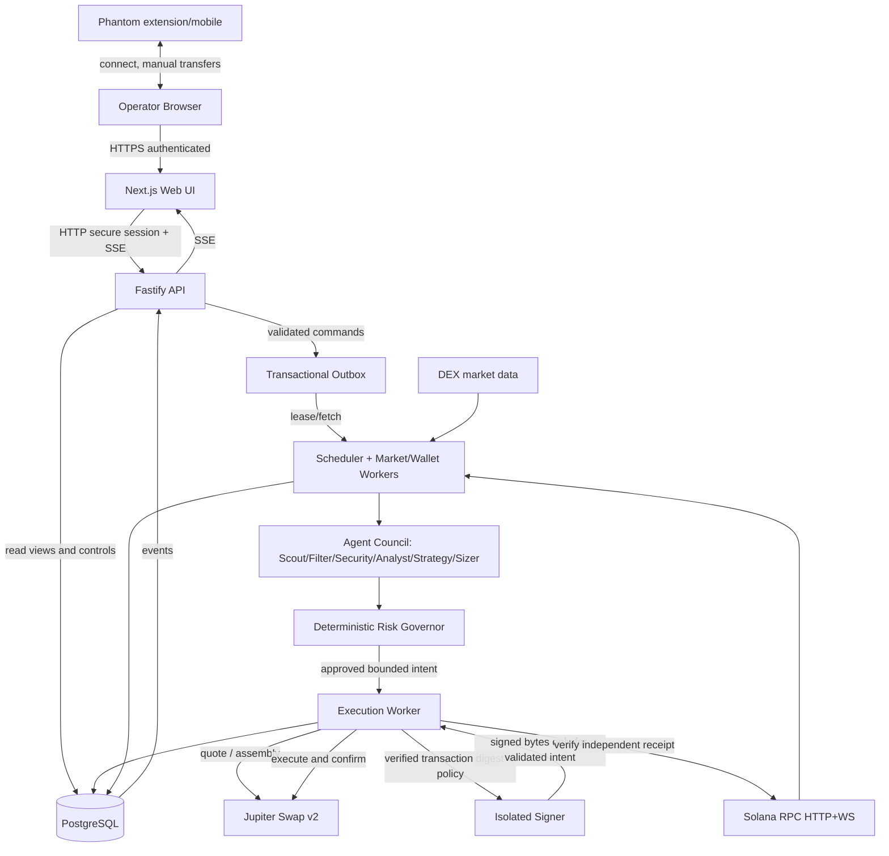

# 02 — System Architecture & Operational Boundaries

## A. Architectural decision

Use **pnpm monorepo** (Node 24 LTS if supported on operator machine, TypeScript strict, pinned lockfile). Frontend `Next.js` App Router; API `Fastify` or equivalent minimal typed HTTP+SSE service; one or more Node workers; **PostgreSQL** for durable, auditable transactional data with row locking and unique constraints; Zod runtime validators/shared types; viem is not a Solana dependency—use maintained official compatible Solana SDK (evaluate `@solana/kit` vs `@solana/web3.js` and ecosystem compatibility via ADR). UI uses semantic accessible components, modern chart library; use Playwright browser tests. Docker Compose for local PostgreSQL and optional web/worker. No Kubernetes, Kafka, Redis, paid cloud or externally hosted LLM required for P0. Runtime must not depend on Codex CLI being open.

**Rationale:** 1 SOL user budget prioritizes inspectability, cost control, and a real single-operator service over needless distributed complexity. Multiple bot **roles** are domain modules, not necessarily 10 separate paid LLMs/servers. Each role must independently execute code, log results and share typed evidence—never simulate a role with static progress animation.

## B. Container / process diagram



### Suggested repo topology (generated by Codex, not preexisting)

```
apps/
  web/                  # Next.js dashboard; never wallet private key
  api/                  # auth, user/admin controls, SSE, read models
  worker/               # feeds, watchlists, agents, scheduler, exit, recovery
  signer/               # isolated service; controlled signing only
packages/
  domain/               # schemas, fixed-point money, reason codes, state
  connectors/           # RPC, Jupiter, DEX providers, wallet decode
  risk/                 # deterministic guards + invariant proofs
  strategy/             # candidate selection + event-based entry/exit
  accounting/           # fill reconstruction & double-entry-ish ledger
  ui/                   # optional shared design system
  testing/              # fixtures, fake clock, provider simulators
ops/                    # Docker, process supervisor, backups, deploy templates
scripts/                # quality gates, evidence validation, wallet verify scripts
```

### Trust boundaries

| Boundary | Allowed | Forbidden |
|---|---|---|
| Browser ↔ API | login, connected public Phantom address, status/commands | keypair, raw signing endpoints, bypassing CSRF, changing spend limit without re-auth |
| API ↔ DB | authenticated commands and read views | client-controlled arbitrary SQL, plaintext secrets |
| feeds ↔ worker | data validated against adapter schemas | feed content as code or prompt override |
| agent output ↔ governor | typed signal/evidence and bounded proposals | LLM direct buy command, higher limits, arbitrary tool calls |
| governor ↔ executor | versioned approved intent with expiry/max spend | free-form `sendTransaction` requests |
| executor ↔ signer | validated canonical intent, transaction digest, context | unexamined swap blob, API passthrough signing of arbitrary bytes |
| signer ↔ blockchain | bounded transactions only | withdrawal to external address, unknown program, changed owner/mint |
| external SDK/chain ↔ ledger | status + verified balance changes | equating broadcast response with settlement |

## C. Event ingestion and time

- Providers need independent adapters with retries, exponential backoff+jitter, rate budget, circuit breaker and contract tests. Record `observed_at`, `source_at`, chain `slot`, commitment, `received_at`, `lag_ms`, `provider_id`, `source_hash`.
- WS disconnect or stale heartbeat => pause new entries; resubscribe, backfill from last durable cursor, dedupe events and alert. Resolve reorg/replaced confirmations; only mark settled after configured commitment.
- Canonical address is **mint public key + chain**, never ticker. Pair/pool address distinct from mint. Unknown decimals and token owner programs => not tradable.
- Chain time is not wall-clock truth; user UI timestamps timezone Asia/Jakarta with UTC stored.
- Price and market caps from analytics providers are context only; actual fill economics from on-chain token changes and executed swap.

## D. Scaling and availability

P0 = single-tenant / one operator, 1 API, 1 market worker, 1 executor, 1 signer, PostgreSQL; scheduler retries after restart. Web UI may close without stopping worker. P1 optional separate signer host/VPS/private network. P2 optional provider fallback or second worker with coordinated durable leases. Never assume highly available 24/7 just because one Docker container restarts.

## E. Failure contracts

1. Worker dies: no new orders, restart backfill and reconciliation before scanning; dashboard marks DEGRADED.
2. DB unavailable: no new entries/signing; in-flight status must be reconstructed from stored signature and chain.
3. One market provider fails: no made-up values, suppress new entries unless independent current quorum exists.
4. Jupiter 429/no route/timeout: retry only safe quote reads; **uncertain signed tx cannot be blindly resubmitted**.
5. Signer off: HALT new live entries but continue observation; alert.
6. Token becomes unsellable: explicit `EXIT_BLOCKED`, loss estimate marked uncertain, alert; cannot promise stop-loss filled.
7. Equity provider divergent: chain reconciler wins for balances; dashboard displays price confidence and reconciliation discrepancies.

## F. Quality attributes

- Event latency SLO is a **target to measure**, not promise: in a healthy network, frontend receives backend state updates within a few seconds; freshness badges derived from real events, not timer display.
- Every command has correlation ID and audit actor; all state mutations transactionally logged.
- API no public trading control without auth; HTTPS on deployment, localhost only for local dev; secrets never on client bundle.
- All critical monetary calculations use `bigint`/decimal fixed-point, never floating-point base-unit mutation.
- Define backpressure and maximum queue age to avoid orders after market opportunity expired.
- Version packages/providers; no unreviewed update directly in production; dependency lock and vulnerability scans.
