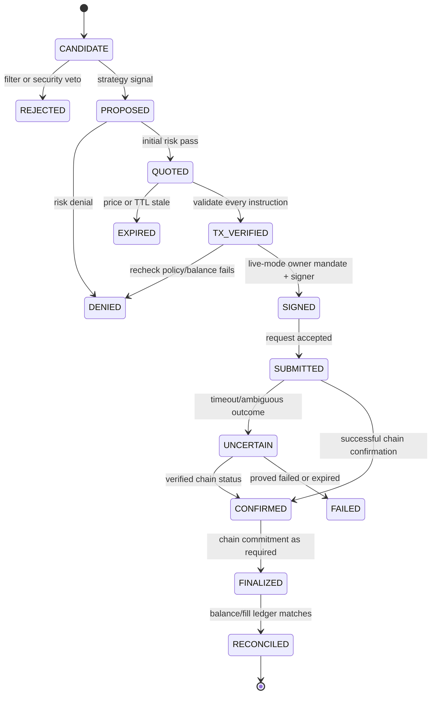

# 04 — Canonical Domain Models, Events, State Machines, Money Types

## A. Modeling conventions

- ID format UUIDv7 or ULID; `correlation_id` spans discover→fill→UI. UTC ISO-8601 timestamps; `slot` as bigint/string; mint/owner address canonical base58 validated. Store money **integer base units as string**, token decimals separate; convert with exact Decimal library only in views.
- Source classification: `LIVE_CHAIN`, `LIVE_PROVIDER`, `DERIVED`, `PAPER_SIM`, `REPLAY`. Never promote simulated values to live facts.
- Data freshness: `provider_timestamp`, `received_at`, `slot`, `ttl_ms`, `freshness`, `confidence`, `provider_status`; reject null risk fields on real buys.

## B. Required typed schemas

### Market candidate

```ts
type TokenCandidate = {
  candidateId: string; chain: 'solana-mainnet';
  mint: string; tokenProgram: string; pairAddress: string | null;
  discoveredAt: string; sourceAt: string | null; observedAt: string;
  observedSlot: string | null; sourceIds: string[];
  poolLiquidityUsd: string | null; volumeUsd5m: string | null;
  marketCapUsd: string | null; decimals: number | null;
  quality: 'COMPLETE'|'PARTIAL'|'UNKNOWN';
}
```

### Risk assessment and decisions

```ts
type Decision = {
  decisionId: string; candidateId: string; runId: string;
  policyVersion: string; strategyVersion: string;
  status: 'BUY_PROPOSED'|'SELL_PROPOSED'|'SKIP'|'DENIED'|'HALTED';
  reasons: string[]; evidenceIds: string[];
  expiresAt: string; stageEvents: string[];
}
type ExecutionIntent = {
  intentId: string; decisionId: string; action: 'BUY'|'SELL';
  walletAddress: string; inputMint: string; outputMint: string;
  amountInBaseUnits: string; minOutBaseUnits: string;
  maxNetworkFeeLamports: string; maxPriceImpactBps: number;
  policyVersion: string; quoteFingerprint: string; quoteExpiresAt: string;
  authorizedBy: 'RISK_GOVERNOR'; ownerActivationId: string;
  status: 'CREATED'|'PRECHECKED'|'QUOTED'|'TX_VERIFIED'|'SIGNED'|'SUBMITTED'|'CONFIRMED'|'FINALIZED'|'FAILED'|'EXPIRED'|'UNCERTAIN'|'CANCELLED';
}
```

### Transaction and ledgers

```ts
type ChainExecution = {
  executionId: string; intentId: string; chain: 'solana-mainnet';
  signature: string | null; signedTxHash: string | null;
  blockhash: string | null; lastValidBlockHeight: string | null;
  submittedAt: string | null; confirmedAt: string | null;
  finalizedAt: string | null; chainSlot: string | null;
  failureReason: string | null; actualFeeLamports: string | null;
  preBalances: Record<string,string> | null;
  postBalances: Record<string,string> | null;
}

type LedgerEntry = {
  id: string; wallet: string; assetMint: string;
  deltaBaseUnits: string; eventType: 'DEPOSIT'|'WITHDRAWAL'|'BUY_FILL'|'SELL_FILL'|'NETWORK_FEE'|'PRIORITY_FEE'|'RENT'|'OTHER_ADJUSTMENT';
  source: 'ON_CHAIN'|'RECONCILIATION'; signature: string | null;
  slot: string | null; eventAt: string; classificationReviewed: boolean;
}
```

Adapt types to actual provider response via explicit adapter + runtime schemas; never use `any` for money/transactions. Example code above defines required semantics, not necessarily exact naming of library implementations.

## C. Agent event envelope

```json
{
  "event_id":"01EXAMPLE0000000000000000",
  "decision_id":"01DECISION00000000000",
  "role":"RUG_CHECK",
  "status":"REJECT",
  "reasons":["MINT_AUTHORITY_UNKNOWN","HOLDER_DISTRIBUTION_UNAVAILABLE"],
  "source_ids":["provider:chain-rpc:slot-example"],
  "policy_version":"v1",
  "created_at":"2026-11-01T00:00:00Z",
  "data_class":"REPLAY",
  "mint":"PLACEHOLDER_NOT_A_REAL_ADDRESS"
}
```

**Never use placeholder example addresses on mainnet.** UI labels all fixtures REPLAY/PAPER.

## D. Trade lifecycle graph



`sendTransaction` response is a broadcast receipt only, not confirmation; `UNCERTAIN` is first-class terminal/holding state requiring recovery. Confirmed tx can fail (inspect meta.err); only successful finality + reconciliation gives fill.

## E. Position lifecycle

`NONE → ENTRY_PROPOSED → OPEN_PENDING → OPEN → EXIT_PROPOSED → CLOSE_PENDING → CLOSED` plus `PARTIALLY_EXITED`, `EXIT_BLOCKED`, `UNKNOWN`, `MANUAL_REVIEW`. Position is inventory derived from chain token deltas, not assumed from submitted request. Treat fee+rent separately; token price without sellable route means mark-to-market uncertain. Track multiple fills, deposits from external sources, manually sold assets and transfers.

## F. Idempotency and concurrency

- Unique key per proposal `(wallet, mint, strategy_id, decision_window, side)` plus correlation; only one active buy per controlled risk slot.
- Durable outbox: write decision/intent+audit in one DB transaction; worker obtains lease/row lock and updates state atomically.
- Before signing, verify persisted intent, policy digest, quote and wallet state. Before re-execution, query DB + chain signature status and reconcile. If signed tx status unknown, do not build another tx for the same intent until resolved/expiry proven.
- Budget reservation is atomic, release after confirmed failure or reconciliation; use DB `SELECT FOR UPDATE`/equivalent to prevent concurrent agent over-spend.
- Backup/restore cannot rewind signed transactions on chain. On restore, import missing chain receipts and synchronize wallet before trading.

## G. Reason codes (minimum shared enum)

`SOURCE_STALE`, `SOURCE_CONFLICT`, `PROVIDER_DOWN`, `INVALID_MINT`, `TOKEN_PROGRAM_UNSUPPORTED`, `MINT_AUTHORITY_ACTIVE`, `FREEZE_AUTHORITY_ACTIVE`, `UNRECOGNIZED_TOKEN_EXTENSION`, `HOLDER_CONCENTRATION_HIGH`, `LIQUIDITY_BELOW_MIN`, `VOLUME_INSUFFICIENT`, `NO_SWAP_ROUTE`, `PRICE_IMPACT_HIGH`, `SLIPPAGE_LIMIT`, `WALLET_INSUFFICIENT_SOL`, `GAS_RESERVE_BREACH`, `POSITION_LIMIT`, `DAILY_LOSS_LIMIT`, `TRADE_RATE_LIMIT`, `COOLDOWN_ACTIVE`, `COPY_SIGNAL_STALE`, `COPY_WALLET_CONFLICT`, `QUOTE_STALE`, `TX_UNVERIFIABLE`, `MALICIOUS_TRANSFER_INSTRUCTIONS`, `SIGNER_LOCKED`, `MODE_NOT_LIVE`, `OWNER_ACTIVATION_MISSING`, `BALANCE_MISMATCH`, `CHAIN_OUTCOME_UNKNOWN`, `KILL_SWITCH_ACTIVE`, `PROVIDER_BUDGET_EXHAUSTED`.

## H. Schema migration policy

Use forward-only reviewed migrations, test data migration from empty and populated DB, indexes/unique constraints for event dedupe, nullable explicit unknown vs numeric zero, no removal of audit data without approved retention policy, all schema versioned. No keys in SQL dumps.
